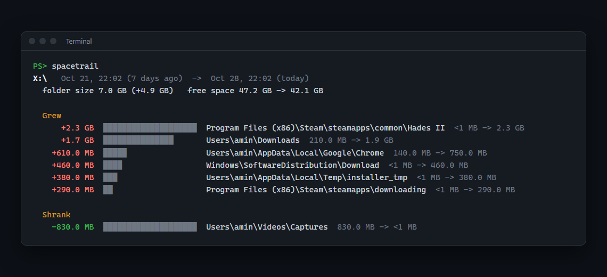

# spacetrail

Your drive was fine last week and now it's full. spacetrail tells you which folders ate the space.

It takes a quick snapshot of your folder sizes every day. When you ask, it compares today with a week ago and lists the folders that grew, pointing at the most specific one: `Downloads`, Chrome's cache, a game update, Windows Update leftovers.



*Example output on a test drive.*

Tools like WinDirStat and WizTree show what's big right now. They can't tell you what *changed*, and a 40 GB game folder that has been there for two years isn't why your disk filled up on Tuesday.

## Install

Needs Python 3.10 or newer. There are no other dependencies.

```bash
pip install git+https://github.com/A2M33/spacetrail
```

## Use

```bash
spacetrail schedule   # take a snapshot every day (Windows Task Scheduler or cron)
spacetrail            # what grew in the last 7 days
```

The first `spacetrail` without any history takes a baseline snapshot. From the second snapshot on you get a report.

| Command | What it does |
| --- | --- |
| `spacetrail` | Report changes since about a week ago |
| `spacetrail --since 1d` | Compare with yesterday (`12h`, `3d`, `2w` and `1m` also work) |
| `spacetrail --fresh` | Take a snapshot now, then report. Good when the disk *just* filled up |
| `spacetrail --min 1GB` | Hide changes smaller than 1 GB (default 100 MB) |
| `spacetrail snap D:\ E:\` | Snapshot other drives or folders |
| `spacetrail report D:\` | Report on one of them |
| `spacetrail list` | Show saved snapshots |
| `spacetrail schedule --time 09:00` | Change the daily time (default 12:30) |
| `spacetrail unschedule` | Remove the daily task |

By default it scans the system drive on Windows (`C:\`) and your home folder on Linux and macOS.

## How it works

- **Scanning.** A plain walk over the drive that adds up file sizes. On my machine a full `C:\` with 800,000 files takes about 10 to 30 seconds. Junctions and symlinks are skipped so nothing is counted twice, and so are other mounted drives and `/proc`-style folders on Linux. Folders it isn't allowed to read are counted and skipped.
- **Storage.** Sizes of folders up to six levels deep go into a SQLite file at `%LOCALAPPDATA%\spacetrail\snapshots.db` (Windows) or `~/.local/share/spacetrail/` (Linux and macOS). Anything deeper is added to its parent at level six. Folders under 1 MB aren't stored, so a snapshot of a full drive is about 1 MB. Snapshots older than 90 days are deleted (`--keep` changes that).
- **Finding the culprit.** If `Users` grew by 10 GB and 9 GB of that is `Users\you\Downloads`, listing all three folders would be noise. A folder is only shown when the subfolders already on the list explain less than 80% of its growth.
- **Daily runs.** On Windows the task is set to "run as soon as possible after a missed start", so a laptop that was off at 12:30 still gets its snapshot. It runs with `pythonw`, so no window pops up.

## Development

```bash
git clone https://github.com/A2M33/spacetrail
cd spacetrail
pip install -e ".[dev]"
pytest
```

Tests run on Windows, Linux and macOS through GitHub Actions.

## License

MIT
